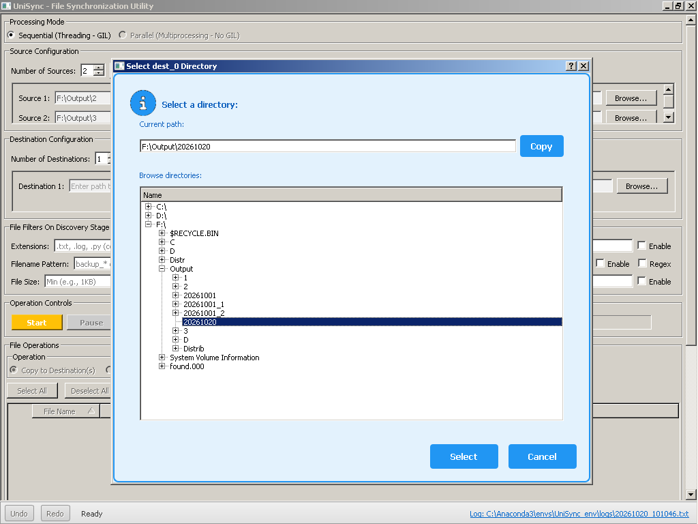
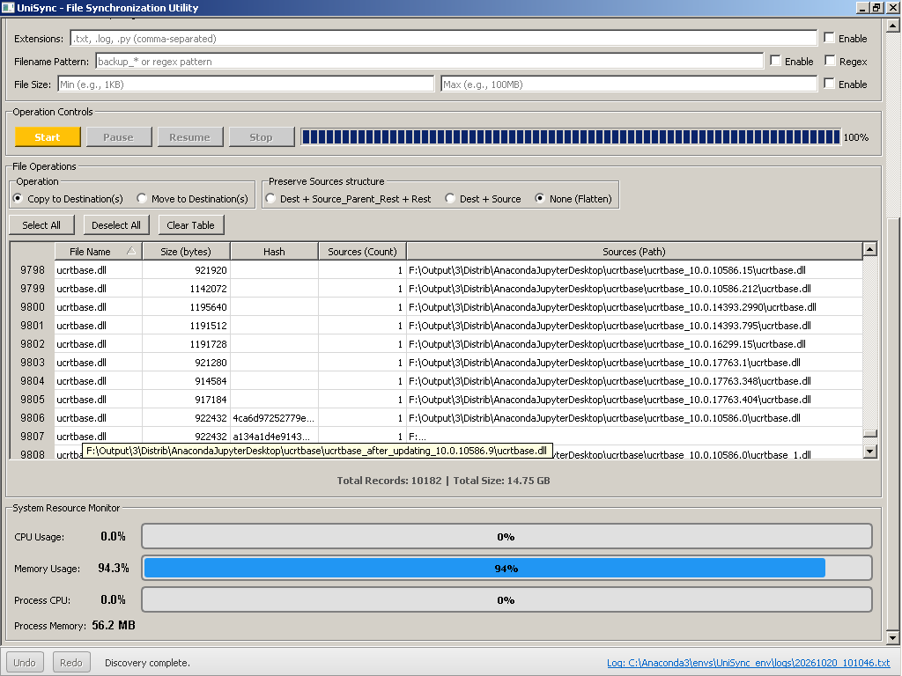
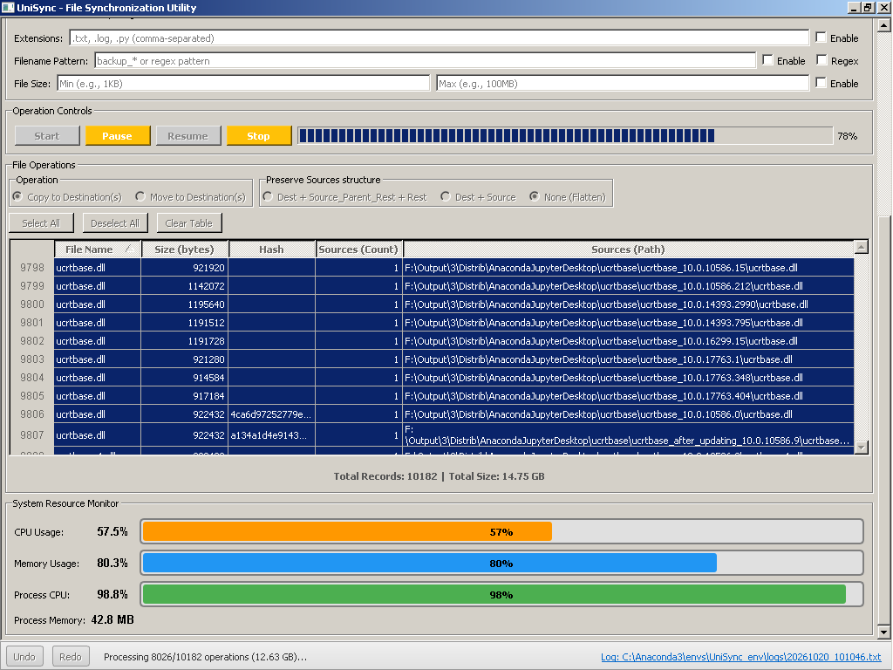
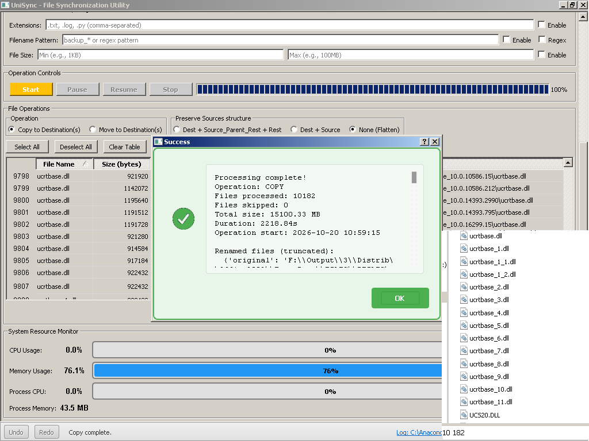
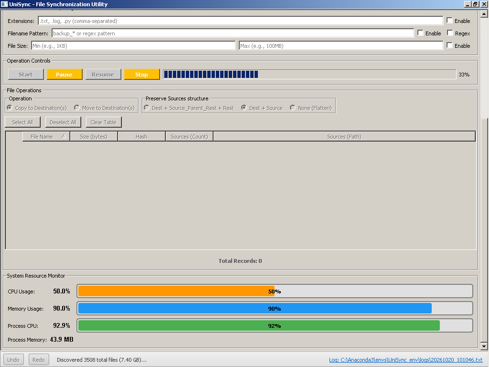

# UniSync - File Synchronization Utility

**Global Aim:** Minimize storage space consumption on physical storage devices (hard drives, USB flash drives, etc.) on Windows

The app **discovers unique files** from up to 20 sources and **copies or moves them** to up to 20 destinations.

## Features
- **Asynchronous processing** — One thread per source directory
- **Smart hashing** during discovery phase for accurate file comparison
- **Intelligent file renaming** during copy/move operations when structure flattening is enabled
- **Real-time resource monitoring** — View CPU, memory, process CPU, and process memory usage
- **Advanced filtering** — Filter by file extensions, names, and sizes during discovery
- **Configuration persistence** — Save and load source/destination lists from .txt files
- **PyQt5-based GUI** — User-friendly graphical interface
- **Undo/Redo functionality** — Revert copy/move operations
- **Comprehensive logging system** — Detailed operation logs
- **Playback controls** — Pause, resume, and stop operations at any time

## Screenshots

#### The main interface with Source/Dest selection



#### The comparison table after discovery phase completed


        
#### The copy/move process with progress



#### After copy/move process completed, Preserve Sources structure - flatten


        
#### Resource monitoring (CPU, Memory display)


    
## Requirements
- Windows 7+ (x32/x64)
- Python 3.x
- PyQt5

## Installation
```pip install -r requirements.txt```

## Usage
---
**1. Configure Source and Destination Paths**

Input the desired number of sources and destinations (up to 20 each). Click the **Browse** button to:

- Enter paths manually, or
- Load paths from a .txt file with the following format:

```
D:\Serg\Build\Programming\Python\Prj\UniSync\Sources\C1
D:\Serg\Build\Programming\Python\Prj\UniSync\Sources\C2
```
---
**2. Filter Files (Discovery Phase)**

To filter files during discovery by extension, name, or size:

1. Input your filter criteria
2. Check the **Enable** flag to apply filters
---
**3. Run Discovery (Phase 1)**

1. Click **Start** to begin the discovery process
2. Monitor progress as files are scanned
3. When complete, a results message will appear — click **OK**
4. The comparison table will populate with unique files from your sources

**If an error occurs:**

- Click **Stop** to halt the process
- Click **Clear Table** to remove incomplete data
- Adjust your input settings and restart discovery
---
**4. Run Copy/Move (Phase 2)**

1. Select records in the comparison table (default: **Select All**)
2. Choose folder structure preservation mode (default: **Dest+Source** — maintains original folder structure)
3. Select **Copy** or **Move** mode
4. Click **Start**

**If needed, undo the operation:**

- Use **Undo/Redo** on the status bar (bottom panel) to restore sources
- You can stop copy/move operations at any time (allow 1–20 minutes for the process to halt)
- Click **Undo** to restore your sources if needed


## Performance
Minimal systems (Windows 7 32-bit, 2 GB RAM)
: Up to 100k records (may freeze after 70,000)

Modern systems
: Up to 500k records

## License
This project is licensed under CC BY-NC — for non-commercial use only.
See LICENSE file for details.

## Disclaimer
This app is provided as-is without any warranties or guarantees, either before or after use. You may use this app for personal or professional purposes, but not for commercial sale or resale.

## Support
If you find this useful, consider supporting development via:
- BTC: bc1q2w7c4xr76wktr4tkacrgczsun0pttdmjdw4c7q
- Ethereum: 0xAB188807A9c0d44bA7D304bf99958E29471e8181
- USDT TRC20: TDrp9FoTESGyCA6XhEKm6YqGKMg61WnJB5